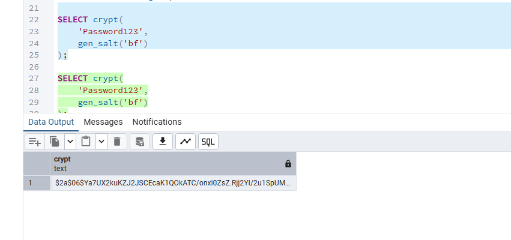
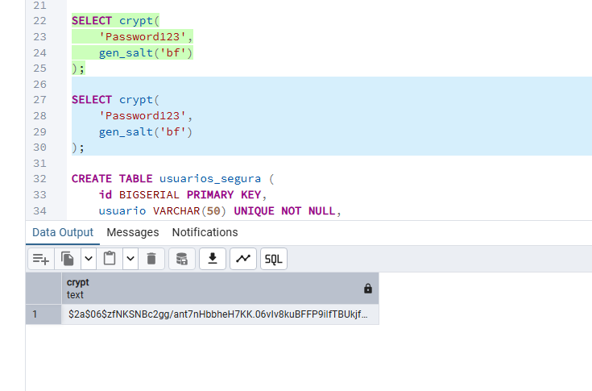

 ## ¿Qué ocurriría si una persona obtiene acceso de lectura a esta tabla?
 Podria ver la contraseña de todos los usuarios y de esta forma hacer mal uso de la informacion
  ## ¿Son iguales? 
  NO
 ## Si no son iguales, ¿por qué?
cada llamada a gen_salt() genera una sal aleatoria diferente, haciendo que la misma contraseña produzca hashes distintos
 ## ¿Qué función cumple gen_salt()?
 Genera una sal aleatoria para calcular el hash y evitar que contraseñas iguales produzcan el mismo resultado.
## ¿Qué función cumple crypt()?
Calcula el hash de la contraseña utilizando la sal proporcionada tambien permite verificar una contraseña comparándola con el hash almacenado.
 ## ¿Esto es cifrado reversible?
 No es un hash unidireccional

  ## ¿Qué resultado obtuviste con la contraseña correcta?
  true bolean
  ## ¿Qué resultado obtuviste con la contraseña incorrecta?
  false bolean
   ## ¿Por qué no es necesario recuperar la contraseña original?
   Porque se calcula el hash de la contraseña ingresada usando la misma sal y se compara con el almacenado.
  ## ¿Por qué un hash no debe confundirse con cifrado?
Porque el hash es unidireccional, mientras que el cifrado permite recuperar el dato original mediante una clave

