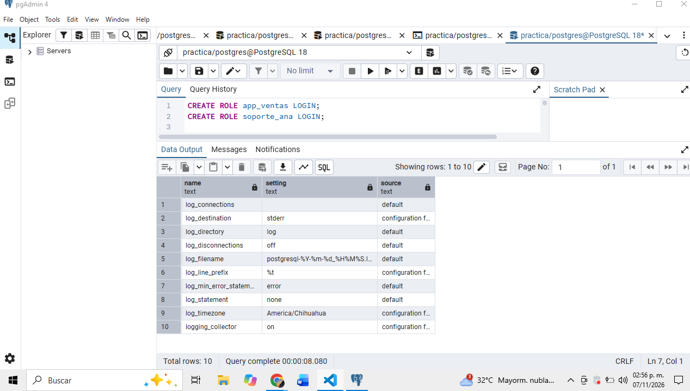

##  Con esta configuracion, ¿se registra quien se conecta?
No, el registro de conexiones no aparece habilitado

## ¿Se registran las sentencias UPDATE?
No, porque log_statement = none. Si un UPDATE produce un error, si podria registrarse

## ¿La linea de bitacora incluye el usuario o la direccion IP del cliente?
No en el prefijo, porque %t solo incluye la fecha y la hora

## ¿En que zona horaria se registran los eventos? ¿Por que importa al reconstruir una cronologia?
Se registran en America/Chihuahua. Conocer la zona horaria permite comparar las horas con otros registros y ordenar correctamente los eventos

## Con logging_collector = off, ¿quien decide donde termina la bitacora: PostgreSQL o el mecanismo con que se desplego el servidor?
Lo decide el mecanismo con que se desplego el servidor

