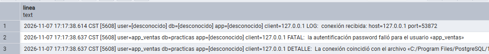

## La bitacora registra el usuario app_ventas en el intento fallido. ¿Eso prueba que la aplicacion de ventas intento entrar? ¿Que prueba realmente?
No. Solo prueba que alguien intento conectarse usando el nombre app_ventas desde 127.0.0.1 y fallo la autenticacion

## ¿Que informacion adicional registra PostgreSQL cuando el rol no existe? ¿Por que aparece en la bitacora y no en el mensaje que recibe el cliente?
Puede registrar un detalle indicando que el rol no existe. El cliente recibe un error general para evitar revelar que usuarios existen.

## ¿Por que app=[unknown] en el intento fallido, pero app=app-ventas-web en la desconexion?
En el intento fallido no se establecio el nombre de la aplicacion. En la conexion exitosa se envio application_name=app-ventas-web y ese nombre aparece al desconectarse

## ¿Que patron de varias lineas te haria sospechar de un ataque de fuerza bruta? Escribe la consulta que contaria los intentos fallidos por usuario.
Muchos errores de autenticacion en poco tiempo, desde la misma IP y contra uno o varios usuarios

