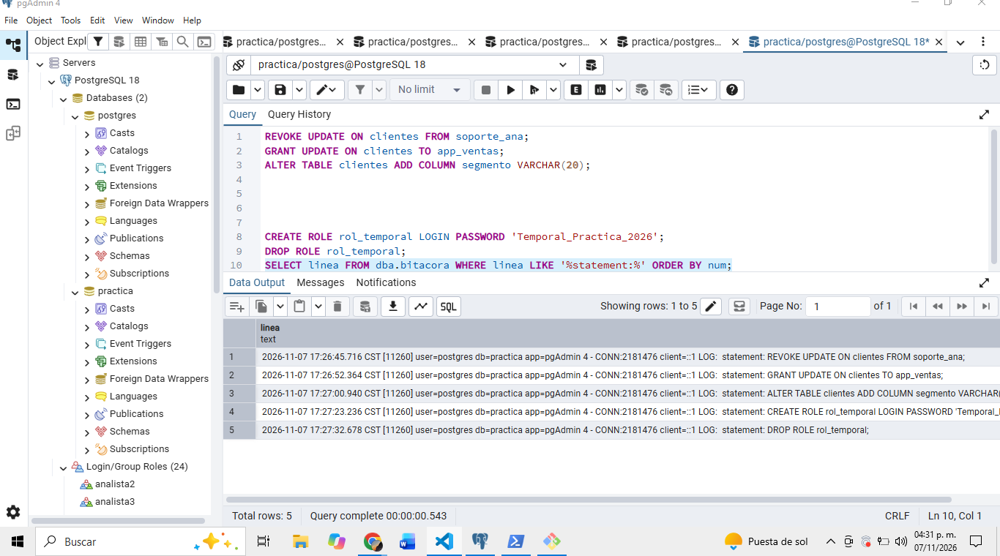

## ¿Qué tipo de evento es cada una de las tres primeras sentencias (privilegio o estructura)?

Revoke y GRANT son cambiois de privilegio, alter es un cambio de estrucutura 

## ¿Por qué GRANT y REVOKE quedan registrados con log_statement = 'ddl'? 
Porque forman parte de statement de ddl asi como create, drop, later comment

## Si la bitácora contiene contraseñas, ¿quién debería poder leerla? Relaciónalo con la gestión de secretos de la Unidad II.
Solo el Admin y el personal autorizado

