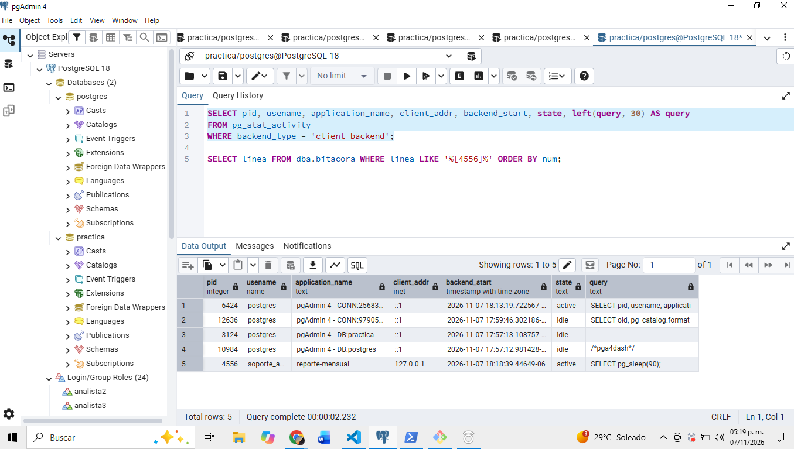
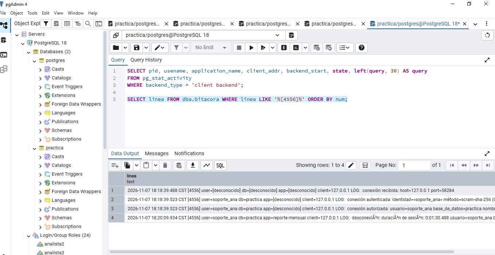

## ¿Que columna permite relacionar una sesion con sus lineas de bitacora?

La columna pid que es 4556

## Despues de que termina el reporte, ¿que fuente conserva evidencia de que existio?
La bitacora conserva los registros de conexion y desconexion

## ¿Por que client_addr aparece vacio en la sesion del administrador?
No aparece vacio

