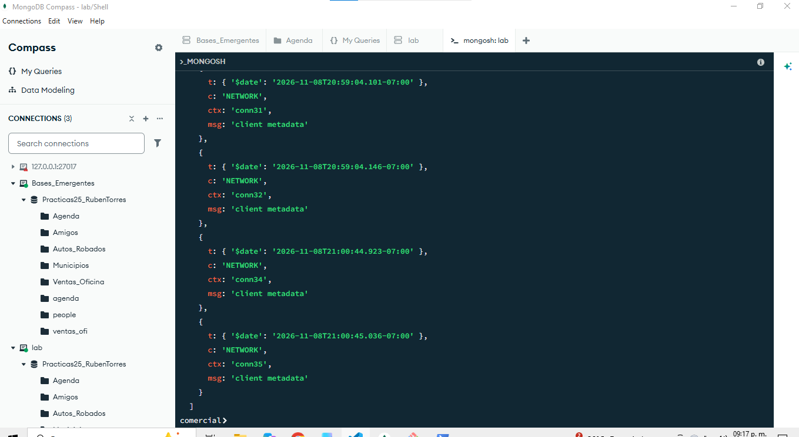

## ¿Puedes demostrar que cambio? ¿Y quien se conecto a esa hora?
No ,el perfilador estaba apagado y la bitacora no muestra la actualizacion

## ¿Por que mongosh abre varias conexiones para una sola instruccion? ¿Cual se autentica?

Porque utiliza conexiones para monitorear el servidor y otras para ejecutar operaciones

