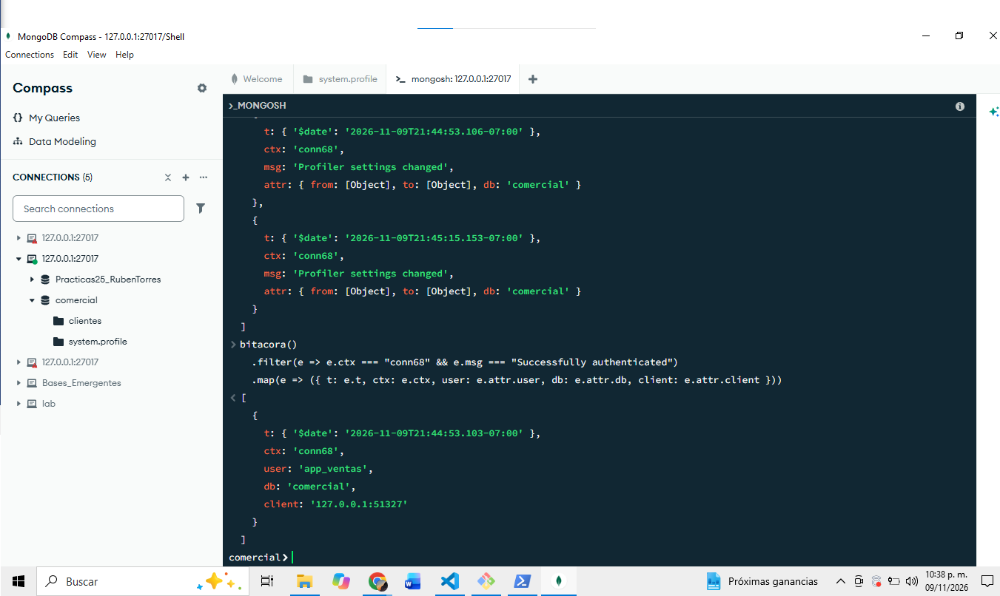

## ¿Que usuario cambio la configuracion del perfilador? ¿Que dos eventos lo demuestran?
Lo cambio app_ventas, lo demuestra la conn68 exitosa y el cambio de perfilador con esta conexion

## ¿Que condicion debe cumplirse para que esta correlacion sea valida?
Los eventos deben pertenecer a la misma conexion y al mismo periodo de ejecucion del servidor, sin reinicios entre ellos

## ¿Por que es relevante registrar cambios del propio mecanismo de registro?
Porque permite detectar cuando alguien desactiva el perfilador o modifica sus filtros

