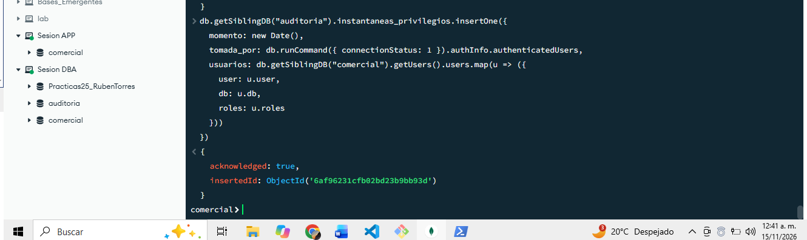
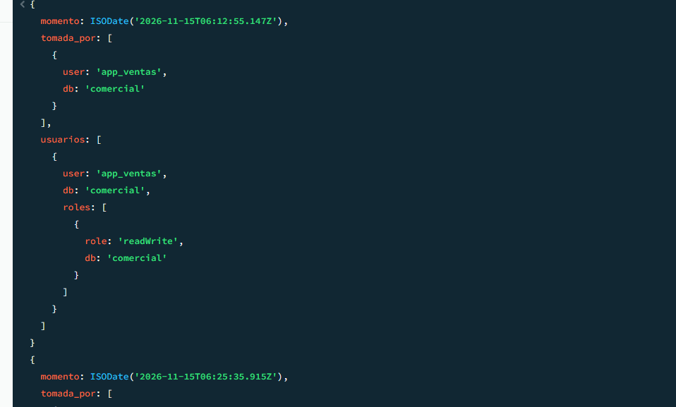

## ¿Por que un cambio de privilegios es uno de los eventos auditables mas importantes?

Porque cambia lo que un usuario puede hacer en la base de datos. Un permiso adicional puede permitir acciones que no le corresponden
## ¿Con que frecuencia tomarias instantaneas? ¿Que factores influyen?

Las tomaria diariamente y antes y despues de cada cambio autorizado de permisos, en sistemas con informacion sensible, las tomaria con mayor frecuencia

## ¿Quien deberia poder escribir en auditoria.instantaneas_privilegios?
Solo una cuenta autorizada para guardar las evidencias, con permiso para insertar registros, pero sin modificarlos ni borrarlos

## Redacta en tres lineas como comunicarias esta limitacion a Direccion.
En la prueba realizada, las busquedas en el perfilador y la bitacora no encontraron evidencia del cambio de privilegios.  
Las capturas muestran que rol se agrego, pero no permiten identificar quien lo otorgo ni el momento exacto.  

