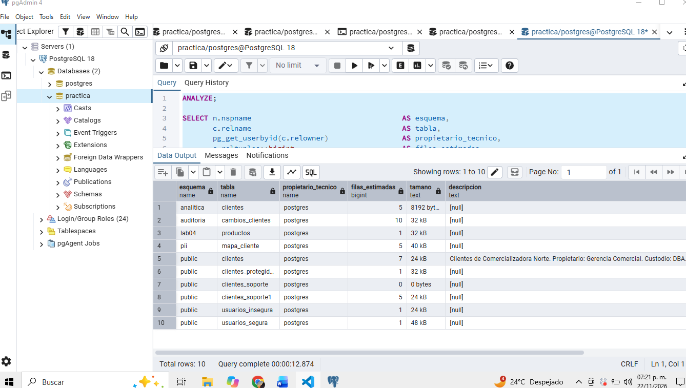

| Registro | Ubicacion actual | Riesgo de perdida | Sensibilidad | Periodo propuesto | Justificacion | Donde se conserva | Quien puede leerlo | Accion al vencer |
|---|---|---|---|---|---|---|---|---|
| Accesos de PostgreSQL | Archivo del colector, indicado por pg_current_logfile() | Rotacion de archivos o perdida del servidor | Alta. Incluye usuarios e IP | 90 dias | Permite investigar accesos fallidos o fuera de horario | Archivo cifrado fuera del servidor | DBA y Seguridad | Eliminar las copias vencidas |
| Cambios de privilegios y estructura | Archivo del colector de PostgreSQL | La rotacion puede eliminar la evidencia de quien cambio un permiso o una tabla | Alta. Revela permisos y estructura | 12 meses | Un permiso indebido puede descubrirse meses despues | Archivo cifrado de estos eventos fuera del servidor | Seguridad y Auditoria | Eliminar al vencer, salvo investigacion abierta |
| Modificaciones de datos | Archivo del colector con log_statement = 'mod' | Rotacion o perdida del archivo local | Alta. Las sentencias pueden incluir RFC, correo o telefono | 30 dias | Permite revisar errores recientes y limita la exposicion de datos personales | Archivo cifrado con acceso restringido | DBA y Auditoria autorizada | Eliminar las sentencias vencidas y sus copias |
| auditoria.cambios_clientes | Base practica, esquema auditoria | Borrado de filas o perdida de la base | Alta. Guarda valores anteriores y nuevos | 90 dias, con revision anticipada si vence el plazo del dato personal | Permite investigar quien cambio un dato y cual era su valor anterior | Tabla protegida y exportacion cifrada fuera del servidor | Auditoria y DBA autorizado | Eliminar los valores personales cuando corresponda, incluidas las copias. Conservar solo evidencia anonimizada si sigue siendo necesaria |
| Bitacora de mongod | Archivo indicado por systemLog.path o salida estandar. getLog conserva eventos recientes en memoria | Reinicio, rotacion o perdida de la salida sin guardar | Alta. Incluye usuarios, IP e intentos de acceso | 90 dias | Permite investigar fallos de autenticacion y compararlos con los accesos de PostgreSQL | Archivo cifrado fuera del servidor MongoDB | DBA y Seguridad | Eliminar las copias vencidas |
| system.profile | Base comercial, coleccion limitada de 1 MB | Los registros nuevos sobrescriben los mas antiguos | Alta. Los filtros pueden incluir datos personales | 7 dias para eventos exportados | Basta para revisar operaciones recientes y reduce el tiempo de exposicion | Exportacion cifrada de los eventos necesarios antes de la sobrescritura | DBA y personal autorizado de monitoreo | Eliminar las exportaciones vencidas |
| Instantaneas de privilegios de MongoDB | auditoria.instantaneas_privilegios | Borrado de la coleccion o perdida de una captura necesaria para comparar roles | Alta. Identifica usuarios y privilegios | 12 meses | Permite comparar permisos entre revisiones trimestrales | Coleccion restringida y exportacion cifrada fuera del servidor | Seguridad y Auditoria | Eliminar las instantaneas vencidas, salvo investigacion abierta |

## ¿Por que los cambios de privilegios merecen mas tiempo de conservacion que las consultas rutinarias?

Un permiso concedido hoy puede usarse meses despues. Conservar el evento permite identificar que cuenta lo concedio y cuando. Las consultas rutinarias suelen revisarse para resolver problemas recientes.

## ¿Que control de integridad aplicaras a las bitacoras exportadas?

Calculare un hash SHA-256 de cada archivo al exportarlo

## ¿Que diferencia hay entre conservar una bitacora y respaldar una base de datos?

La bitacora permite reconstruir que ocurrio, cuando y con que cuenta. El respaldo permite recuperar los datos y la estructura de la base despues de una perdida

